# WildID

**Discover the entire animal kingdom.** WildID is a native iPhone app (Swift / SwiftUI) for identifying, collecting and exploring animals — inspired by the interaction patterns of Merlin Bird ID, extended from birds to all animals.

Tabs: **Home · Map · Wild Index · Wildlings**. Identification (Sound ID, Photo ID, Step by Step and saved sessions) opens from Home, from the Listen/Photo/Step tiles or the ✦🔍 button in the header.

- **Sound ID** – live microphone identification, tuned to be **as sensitive as possible**: a 3 s window is classified every second and the default *Sensitive* setting accepts scores down to 0.15, so a quiet, distant call or a bird flying over can be named. The model ignores loudness (a call 50 dB quieter scores the same), so faint sounds aren't penalised. To keep false alarms down, an animal is added to the Wild Index only once it's heard in two overlapping windows (or once with ≥ 0.7), and the location/season filter drops species that don't occur where you are. It also has a real scrolling spectrogram (FFT), detections appearing as they happen, a yellow highlight for newly heard species, sessions up to **3 hours** that keep running with the screen locked, and **Save** to keep the whole recording (size shown in MB/GB, deletable).
- **Wild Index** – your Pokémon-style collection: one card per species, a journal of every catch (date, place, method, confidence, your photo, the sound clip you caught), rarity, achievements, and "yet to catch nearby" silhouettes. Detections are added automatically and a small **New Animal** pop-up slides in without interrupting recording.
- **Map** – Apple Maps (MapKit) with your catches as photo pins (clustered), recent community sightings, an all-observations layer, species ranges and satellite view.
- **Explore** – animals recorded near you this season (or anywhere you pick on the map), plus a worldwide search across every animal on iNaturalist.
- **Species pages** – photo gallery, sounds (Xeno-canto + iNaturalist) with recordist and license, weekly seasonality near you, range map vs. occurrence records (kept separate), size/mass/lifespan (Wikidata), description/habitat/diet/behaviour/reproduction/conservation (Wikipedia), full taxonomy, conservation status, similar species, sources.
- **Wildlings** – every animal you catch also becomes a companion (with a built-in "How Wildlings work" guide): XP, levels 1–50, rarity tiers from **Common to Legendary** (based on how rarely it's recorded where you found it, boosted for threatened species), nicknames, favourites, a game-style card and detail page, and a slot for a 3D model. No battles, nothing to buy, and XP can't be farmed (see below).
- **Photo ID** (species-level for 965 birds and 1,021 insects when the photo models are built; group-level + local candidates for everything else) and **Step by Step** guided identification.
- **Survives reinstall** – your catches, XP, levels and nicknames are kept in this iPhone's Keychain (device-only, no account, never uploaded). Delete the app, install it again on the same phone → everything is back. Anyone else's phone starts empty.

> WildID needs an internet connection for species data, photos and maps. Your Wild Index, catches, clips, saved recordings and previously opened species pages stay available offline.

### Screenshots

Captured automatically on the iOS Simulator by the *Simulator screenshots* workflow (sample catches, live data around Monnickendam).

| | | |
|---|---|---|
| **Home**<br>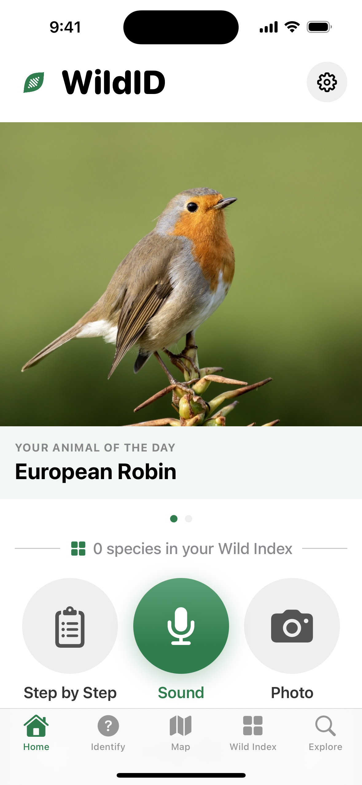 | **Identify hub**<br>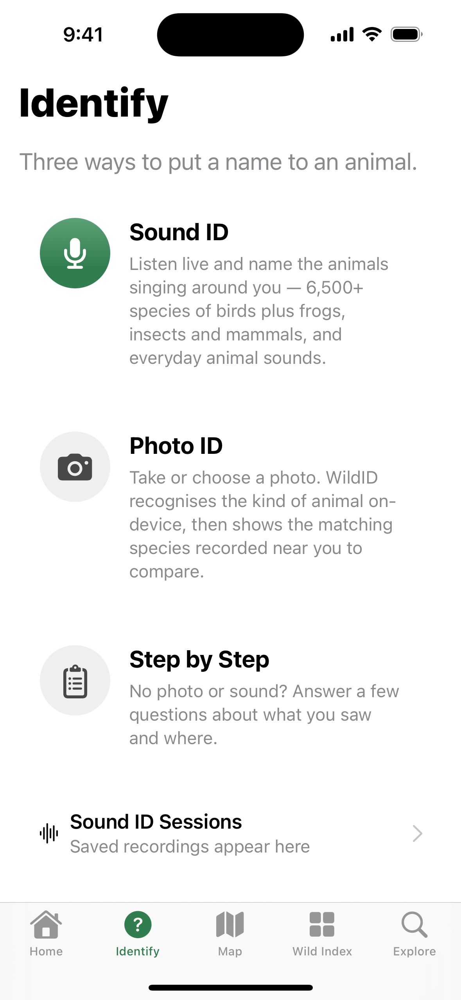 | **Sound ID**<br>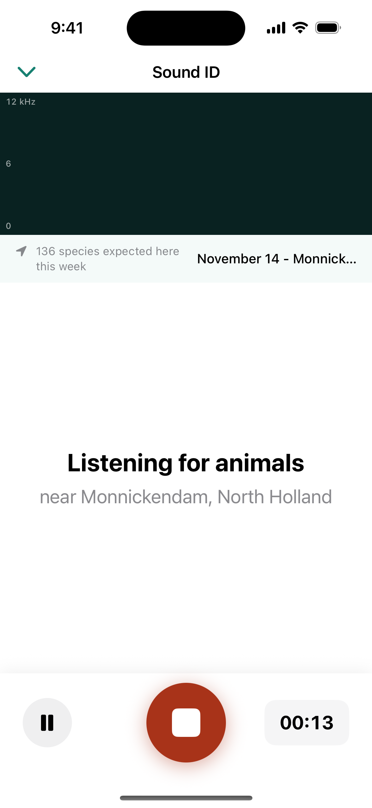 |
| **Photo ID**<br>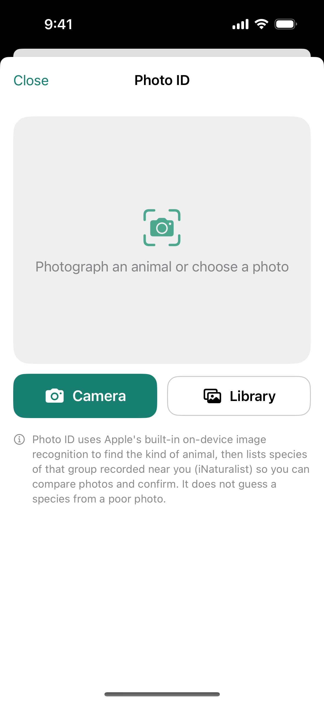 | **Step by Step**<br>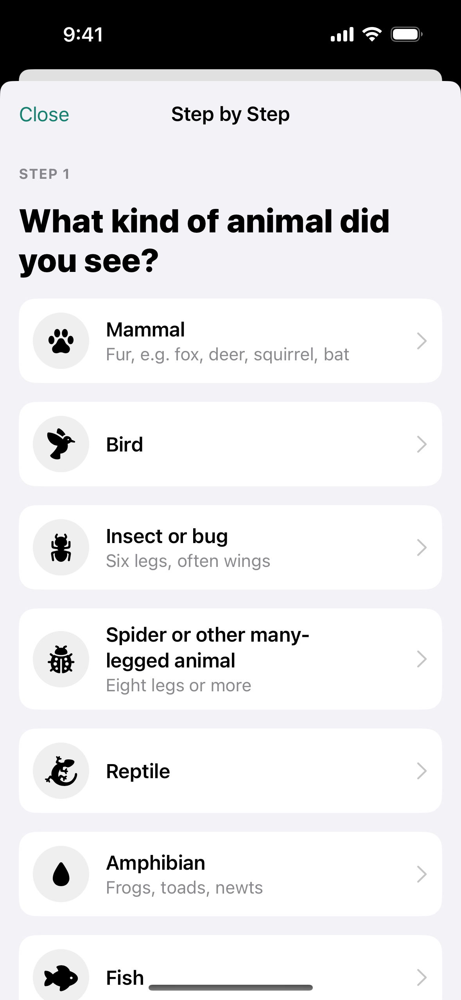 | **Saved sessions**<br>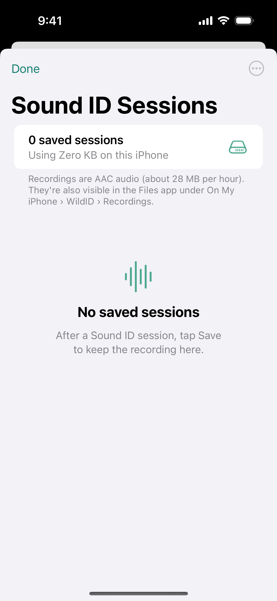 |
| **Map · both**<br>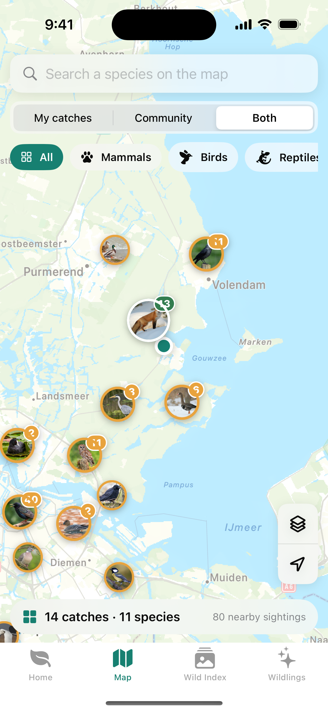 | **Map · my catches**<br>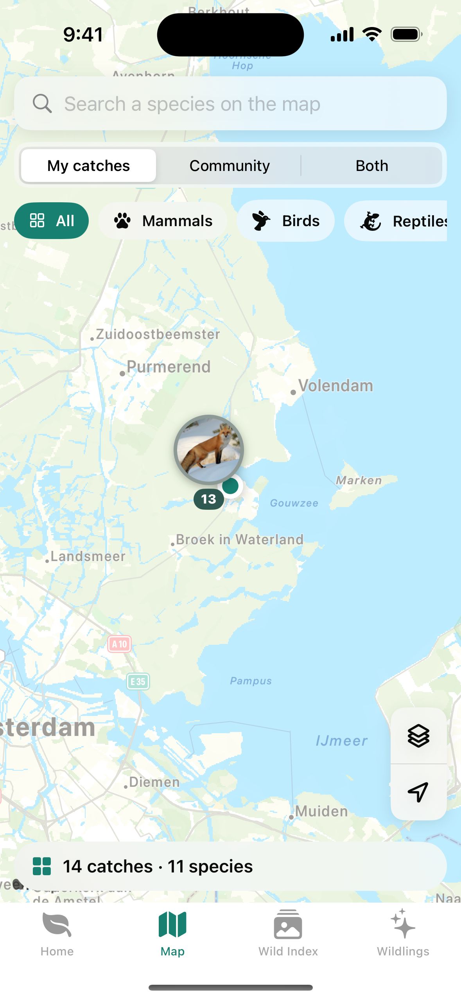 | **Map · community**<br>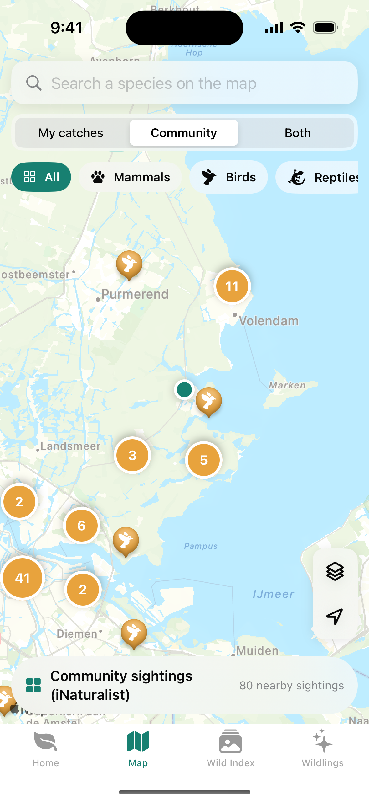 |
| **Wild Index**<br>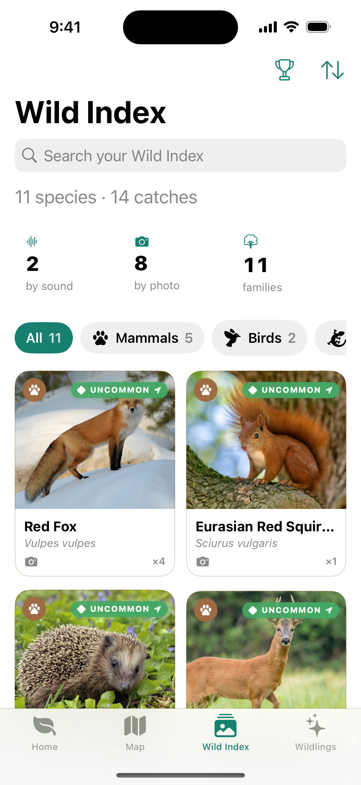 | **Wild Index entry**<br>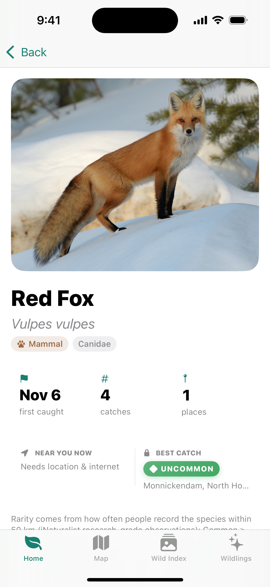 | **Achievements**<br>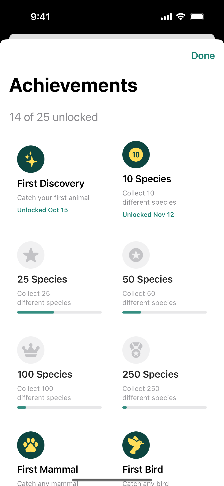 |
| **Wildlings**<br>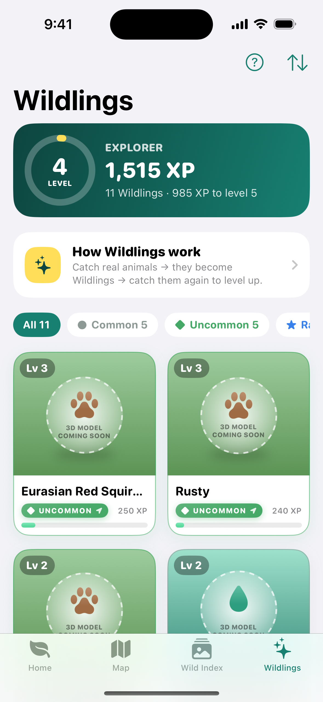 | **Wildling detail**<br>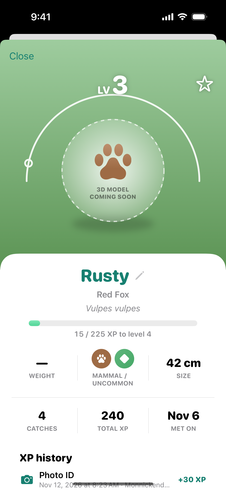 | **How Wildlings work**<br>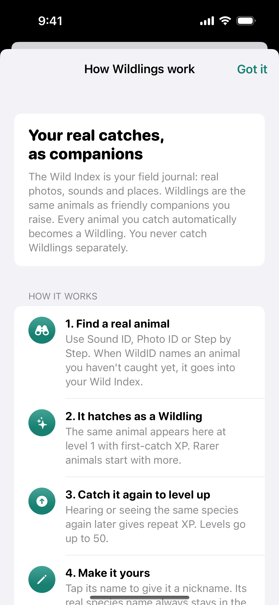 |
| **Explore**<br>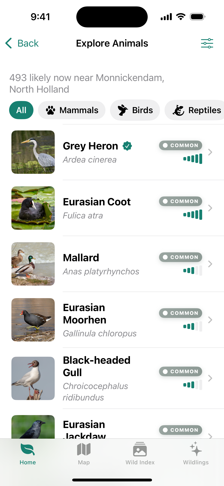 | **Species page**<br>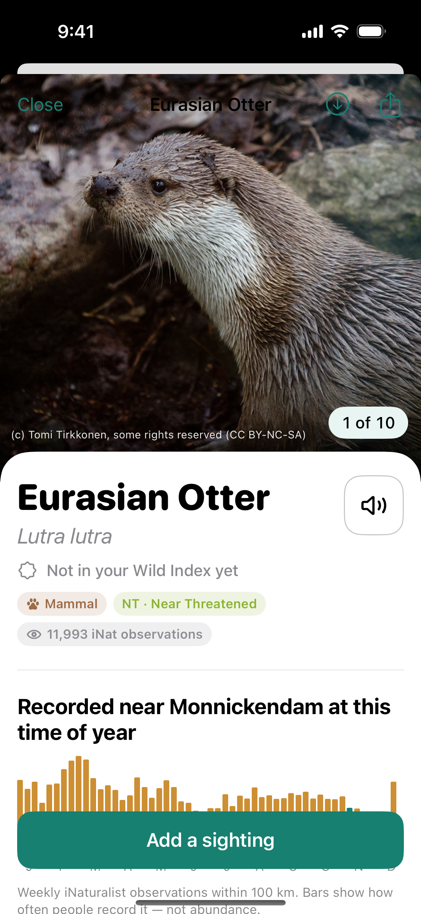 | **Settings**<br>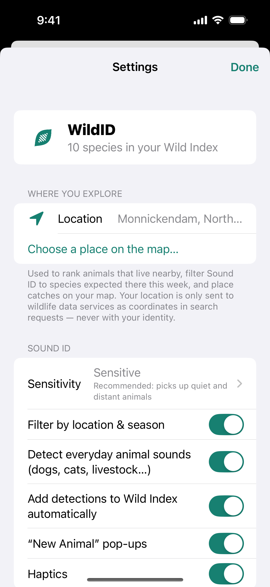 |

### Wildlings rules (fair play)

| Tier | Local records within 50 km | First catch | Each repeat catch |
|---|---|---|---|
| Common | ≥ 500 | +100 XP | +20 XP |
| Uncommon | 100–499 | +150 XP | +30 XP |
| Rare | 20–99 (or IUCN Vulnerable) | +250 XP | +45 XP |
| Epic | 5–19 (or Endangered) | +400 XP | +70 XP |
| Legendary | < 5 (or Critically Endangered) | +700 XP | +100 XP |

Repeat catches earn XP at most once per hour per animal and 3 times a day; Step by Step earns half and manual sightings a quarter (they can't be verified); XP time is recorded when it is granted, so backdating a sighting doesn't help; Sound ID adds each species once per session. Levels: 2 at 75 XP, 5 at 750, 10 at 3,375 … up to 50. Your **Explorer level** sums all your Wildlings.

### 3D models

The Wildlings tab loads a real 3D model (`models3d/<genus_species>.usdz`, listed in `models3d/index.json`) the moment one is published to this repo — no app update needed. Until then it shows a clean "3D model coming soon" placeholder (no low-quality auto-generated models).

---

## Install it on your iPhone (no App Store needed)

You need a **Mac with Xcode 16 or newer** (free from the Mac App Store) and an **Apple ID**. A free Apple ID works; apps installed with a free account must be re-installed every 7 days. A paid Apple Developer Program membership ($99/year) removes that limit.

1. **Get the code**
   ```bash
   git clone https://github.com/Youtube77077/WildID.git
   cd WildID
   git checkout claude/festive-tesla-rhpbyd   # or main once merged
   open WildID.xcodeproj
   ```
2. **Sign in to Xcode**: *Xcode › Settings › Accounts › +* → Apple ID.
3. **Set signing**: in the project navigator select **WildID** (blue icon) → target **WildID** → **Signing & Capabilities** → tick *Automatically manage signing* → choose your **Team** (e.g. "Your Name (Personal Team)").
4. **Make the bundle ID unique** (Apple requires this). Either edit `Config/WildID.xcconfig`:
   ```
   WILDID_BUNDLE_IDENTIFIER = com.yourname.wildid
   ```
   or create `Config/Local.xcconfig` (git-ignored) containing that line and `DEVELOPMENT_TEAM = YOURTEAMID`.
5. **Connect your iPhone** with a cable (or same Wi-Fi after pairing once), unlock it and tap *Trust*.
6. **Enable Developer Mode on the iPhone** (iOS 16+): *Settings › Privacy & Security › Developer Mode* → on → restart.
7. In Xcode's toolbar pick your iPhone as the run destination and press **▶ Run** (⌘R).
8. First launch with a free account: on the iPhone go to *Settings › General › VPN & Device Management* → your Apple ID → **Trust**. Then open WildID.
9. Allow **Microphone** (Sound ID), **Location** (nearby animals, filtering, map) and **Camera/Photos** (Photo ID) when asked.

Requirements: iOS 17.0 or later, iPhone. App size ≈ 50 MB (most of it is the BirdNET sound model).

### Alternative: install the .ipa (no Mac needed for building)

Every push builds **`WildID.ipa`** (workflow *Build WildID.ipa* → artifact `WildID-ipa`), and the current build is also kept at [`dist/WildID.ipa`](dist/WildID.ipa). iPhones only run apps signed for them, so the .ipa must be signed with your Apple ID once:

1. Download `dist/WildID.ipa` (or the `WildID-ipa` artifact from the latest workflow run).
2. Install **Sideloadly** (Windows/Mac) or **AltStore**, connect your iPhone, drag in the .ipa, enter your Apple ID → Start. (Use the same Apple ID every time so your saved catches stay readable after reinstalling.)
3. On the iPhone: *Settings › General › VPN & Device Management* → trust your Apple ID; enable *Developer Mode* if asked.

Free Apple IDs need a refresh every 7 days (Sideloadly/AltStore can do it); a paid developer account lasts a year.

---

## How many animals?

Measured from the live sources by `tools/stats/dataset_stats.py` (2026-11-14):

| Group | Species you can open in WildID | Subspecies ("races") | Species with photos | Species with sound recordings | Described species in the world (approx.) |
|---|---|---|---|---|---|
| Birds | 11,387 | 20,244 | 11,290 | 7,625 | ~11,250 |
| Mammals | 6,870 | 4,521 | 4,813 | 1,107 | ~6,800 |
| Reptiles | 12,680 | 2,993 | 9,732 | 195 | ~12,500 |
| Amphibians | 9,029 | 196 | 6,359 | 2,000 | ~8,900 |
| Fish | 37,068 | 304 | 18,727 | 72 | ~37,000 |
| Insects | 517,282 | 36,180 | 235,963 | 2,732 | ~1,000,000 |
| Arachnids | 69,848 | 898 | 18,354 | 61 | ~110,000 |
| Molluscs | 50,768 | 2,239 | 21,775 | 32 | ~85,000 |
| Crustaceans | 21,329 | 382 | 9,734 | 31 | ~70,000 |
| **All animals** | **776,090** | **68,540** | **350,731** | **13,885** | **~1,500,000** |

Search falls back to the GBIF backbone for named species iNaturalist doesn't have (usually without photos). **Sound ID** names 6,509 animal species: 6,420 birds, 41 amphibians, 40 insects, 7 mammals (plus Apple's built-in groups such as dogs, cats, frogs, crickets, owls).

## How identification works (and its limits)

| Feature | What it uses | Coverage |
|---|---|---|
| Sound ID – species | **BirdNET V2.4** acoustic model (Cornell Lab of Ornithology & TU Chemnitz) converted to Core ML, on-device, 3 s windows every 1 s, threshold 0.15 by default (0.08–0.5 in Settings), auto-add after 2 windows | 6,522 classes: mostly birds worldwide, plus some frogs, insects and mammals |
| Sound ID – location filter | **BirdNET meta-model**: species expected at your latitude/longitude in the current week (48-week calendar) | Same classes |
| Sound ID – other animals | **Apple SoundAnalysis** built-in classifier (iOS, zero app size) | Dogs, cats, livestock, frogs, crickets/insects, owls, crows, ducks, whales… mostly *groups*, shown as "Possible: …" and never auto-added |
| Photo ID | **Apple Vision** on-device image classification → mapped to a scientific group → species of that group recorded near you (iNaturalist) to compare and confirm | Common animal types; species chosen by you, never guessed from the photo alone |
| Step by Step | A question tree (shape, size, legs, wings…) mapped to real taxa → species recorded at the place/season you choose | All animal groups |

**Measured accuracy (real recordings).** On 160 research-grade iNaturalist recordings of the 40 bird species most often recorded within 50 km of Monnickendam (run 2026-11-14), BirdNET as shipped in WildID ranked the true species first in **79.4%** of recordings (**80.6%** with the location/week filter) and in the top five in **91.9%** (**94.4%** filtered). The filter reduced extra species above the 0.5 threshold from 0.62 to 0.37 per recording. Full per-recording results: [`tools/eval/reports/birdnet_eval.md`](tools/eval/reports/birdnet_eval.md).

**Validation.** `tools/models/convert_birdnet.py` checks that the Core ML model reproduces TensorFlow's output (top-1 identical on a real Eurasian Blackbird recording, max logit difference ≈ 0.07). `tools/eval/evaluate_birdnet.py` (workflow *Evaluate BirdNET on real recordings*) scores the model on research-grade iNaturalist recordings of birds around Monnickendam and writes `tools/eval/reports/birdnet_eval.md`. Unit tests run the bundled model on the real recording on the iOS Simulator.

**Honest limits.** Bird song identification is mature; insects, bats (ultrasonic — phones can't hear them) and marine mammals are only partly covered; group-level detections are not species identifications; photo identification relies on you to confirm the species. Rarity labels describe how often a species is *recorded* within 50 km on iNaturalist, not its population.

---

## Architecture

```
WildID/
  App/            WildIDApp, RootView (5 tabs + New Animal toast + listening pill), AppEnvironment, Router, NearbyStore
  Audio/          AudioCaptureEngine (AVAudioEngine → 48 kHz mono + streaming AAC file, interruptions, 3 h cap)
                  Spectrogram (vDSP FFT, adaptive noise floor, CADisplayLink renderer)
                  BirdNETClassifier (Core ML audio + meta model, location/week filter)
                  AppleSoundClassifier (SoundAnalysis), SoundIDSession (pipeline, detections, auto-catch, save)
                  AudioPlayer (reference sounds, clips, recordings)
  Services/       HTTPClient (rate limits, disk cache, offline fallback), INaturalist, EncyclopediaSources
                  (Wikipedia, Wikidata, GBIF, Xeno-canto), Collection (Wild Index manager, taxon resolver, toasts),
                  PlatformServices (location, connectivity, settings, Keychain)
  Models/         SwiftData: WildIndexEntry, Catch, SavedRecording, RecordingDetection; AnimalGroup
  Features/       Home, Identify (Sound ID, sessions, Photo ID, Step by Step), Map, WildIndex, Explore, Species, Settings
  Design/         Theme, components, cached remote images, New Animal toast
  Resources/      Assets, BirdNETAudio.mlpackage, BirdNETMeta.mlpackage, labels (generated by CI)
WildIDTests/      Unit tests (+ reference vectors produced by the conversion workflow)
tools/
  models/         BirdNET → Core ML converter (RFFT rewritten as DFT matmuls, validated), reports
  eval/           Accuracy evaluation on real recordings
  ingest/         Xeno-canto metadata ingestion (resumable) and audio dataset builder (licenses, resampling,
                  de-duplication, spectrograms, recordist-based splits)
.github/workflows iOS build & tests · model conversion · evaluation · Xeno-canto index
```

**Data layer.** Species identity is the iNaturalist taxon (stable IDs, synonyms resolved); classifier labels are matched by scientific name and cached. Everything is fetched on demand from public APIs — no huge static files in the app. Responses are cached on disk so opened pages work offline. Map overlays (observation points, ranges, GBIF density) are rendered server-side as tiles, which keeps the app light.

**Privacy.** Only coordinates and species names are sent to the wildlife APIs — never your identity. Sensitive species are excluded from community map markers (`geoprivacy=open`, `taxon_geoprivacy=open`), and Xeno-canto withholds restricted-species locations.

---

## Secrets (Xeno-canto API key)

- The key is **never** in the app, Info.plist, or repository.
- GitHub Actions reads it from the repository secret **`XENO_CANTO_API_KEY`** (*Settings › Secrets and variables › Actions › New repository secret*). If you stored it under another name or in a GitHub *Environment*, add/rename it to `XENO_CANTO_API_KEY` as a repository secret — the *Xeno-canto index* workflow skips with a notice until it exists.
- The workflow builds `data/xeno-canto/species/*.json` (best recordings per species with recordist + license); the app reads these public files, so it needs no key.
- Optionally you can paste your own key in the app (*Settings › Xeno-canto*); it is stored in the iPhone Keychain only.
- See `.env.example` for local tooling.

## Testing

- **Unit tests** (`WildIDTests`, run in Xcode with ⌘U or by CI): taxonomy/group mapping, rarity, Vision label matching, honest Apple-sound mappings, Wikipedia section parsing, Wikidata formatting, BirdNET week calendar, meta-model encoding vs. TensorFlow reference values, **Core ML inference on a real Blackbird recording**, location/season filtering, FFT spectrogram frequency accuracy, AAC clip round-trip, sample ring buffer, Wild Index de-duplication (one card per species, many catches, group-level detections never collected) and achievements.
- **CI workflows**: `iOS build & tests` (device build + simulator tests + unsigned .ipa), `Simulator screenshots` (launches every screen with live data at Monnickendam and commits `docs/screenshots/`), `Convert models`, `Evaluate BirdNET on real recordings`, `Xeno-canto index`.
- **On your iPhone** (things a simulator can't test): microphone permission and live recording, spectrogram updating, detections + yellow highlight + New Animal pop-up, locking the screen during a session, a phone call interrupting (session pauses and resumes), saving/deleting recordings, camera Photo ID, location accuracy of catches on the map.

## Running the tooling locally

```bash
python3 -m venv .venv && source .venv/bin/activate
pip install -r tools/models/requirements.txt          # macOS for Core ML validation
python tools/models/convert_birdnet.py --out WildID/Resources/Models --work work
pip install "tensorflow==2.17.0" "numpy<2" && brew install ffmpeg
python tools/eval/evaluate_birdnet.py --lat 52.46 --lng 5.03
export XENO_CANTO_API_KEY=...                           # never commit it
python tools/ingest/xeno_canto_ingest.py index && python tools/ingest/xeno_canto_ingest.py shards
python tools/ingest/build_audio_dataset.py --place-lat 52.46 --place-lng 5.03 --top 30 --source both --spectrograms
```

## Data sources & licenses

- **BirdNET V2.4** models — CC BY-NC-SA 4.0 (non-commercial; converted models in `WildID/Resources/Models` keep this license). https://birdnet.cornell.edu
- **Xeno-canto** recordings — each under its own Creative Commons license, credited to its recordist.
- **iNaturalist** — taxonomy, photos and sounds (each item shown with author and license), observations, range tiles.
- **GBIF** — backbone matching and occurrence density maps.
- **Wikipedia** (CC BY-SA 4.0) and **Wikidata** (CC0).
- Test recording: iNaturalist observation 110684075, © Codrin Bucur, CC BY.

WildID is an independent, non-commercial project and is not affiliated with the Cornell Lab of Ornithology or Merlin Bird ID. App source code: MIT (see `LICENSE`).
